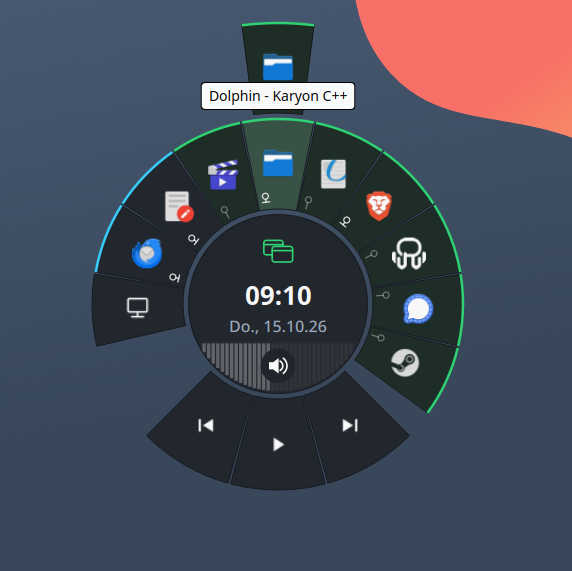

# Karyon

Radial overlay launcher for KDE Plasma 6 (Wayland & X11). Fast, cursor-centered multitasking, window management, and desktop navigation.



Hold your trigger button (default: RMB) to open a sleek radial menu right at your cursor. Karyon provides instant access to open windows, apps, recent files, and system controls — letting you completely hide traditional desktop panels for a clean, distraction-free workspace.

---

## Features & Controls

### 1. General Controls
* **Trigger & Select:** Hold the trigger button to open. Hover over an item and release to activate.
* **Cancel:** Left-click while open to dismiss without action.
* **Category Switch:** Scroll the mouse wheel inside the hub to cycle through **Windows**, **Apps**, and **Files**.
* **Volume Control:** Scroll inside the volume arc at the bottom of the hub.
* **Mute Audio:** Middle-click anywhere inside the hub to toggle mute.
* **Media Controls:** Dynamic controls (Prev / Play-Pause / Next) appear automatically when media is active.
* **Window Management:** Hover directly over a window icon in the ring:
  * **Scroll Up:** Maximize / Restore
  * **Scroll Down:** Minimize / Restore
  * **Middle-Click:** Close window

### 2. Navigation & Rings
* **Concentric Rings:** Open windows and apps are organized in rings by Most Recently Used (MRU) order.
* **Drill-Down Bars:** Hovering the outer edge opens submenus, categories, or grouped window lists.
* **Context Badges:**
  * **Window Counter / Group Close:** Shows open window count; hover the counter to close the whole app group.
  * **Pinning:** Hover the pin icon and release to permanently pin favorite apps or files.
  * **Job Progress:** Displays active progress rings for ongoing file transfers and downloads (KIO).

### 3. Gestures (Trigger + Quick Swipe)
* **Instant Actions:** Hold the trigger and immediately flick the mouse in one of 8 directions (copy, paste, desktop switch, etc.). Executes instantly without opening the visual overlay.
* **Trail Visualizer:** Optional visual trail to assist gesture feedback (toggleable in settings).

### 4. Hub & Desktop Integration
* **Central Hub:** Displays active category, clock, date, and status indicators.
* **System Tray:** Access running tray icons and open their native Plasma popup menus.
* **Session Controls:** Fast access to lock, logout, suspend, restart, and shutdown.
* **Show Desktop:** Toggle desktop visibility directly from the ring.

### 5. Game Mode & Deep Sleep
* **Auto-Detection:** Automatically detects games (Steam, Lutris, Heroic, Wine/Proton).
* **Zero Overhead:** Suspends polling and forwards mouse input 1:1 with zero overhead while in-game. Wakes up immediately when returning to desktop apps.

---

## Configuration

Accessible via the tray icon or the overlay settings segment:
* **Trigger Button / Key:** Configure RMB, extra mouse buttons, or keyboard shortcuts.
* **Timings & Speed:** Adjust hold trigger delay (ms) and overlay mouse speed.
* **Appearance:** Customize scale (up to 1.5x), transparency, and date/time format.
* **Toggles:** Enable or disable individual categories, gesture trail, media/volume controls, and Game Mode.

---

## Architecture
* **Low-Level Input (evdev / uinput):** Low-latency interception of trigger events across Wayland & X11 via a virtual input device without desktop compositor restrictions.
* **Frameless Top-Level Window:** Rendered directly over all windows and full-screen apps via `Qt::BypassWindowManagerHint`.
* **GPU-Accelerated Qt Quick:** Hardware-accelerated vector drawing with sub-millisecond render latency.

---

## Things to keep in mind
* **Be patient:** Give your brain and muscle memory some time to adapt. Once you do, Karyon will make your workflow much smoother.
* **Drag & drop:** Dropping files in another window is faster than before. Grab file with left mouse button, call up destination window with Karyon (hold right mouse button), aim and release right button to raise the window, drop file.
* **Icon fallbacks:** Not all window icons are guaranteed to display; missing ones are replaced by text titles.
* **System tray:** Completely removing the system tray from your desktop can limit some KDE functions (like the clipboard). If you need Klipper, I recommend keeping the system tray active somewhere on the desktop and hiding all elements. Karyon is generally unable to invoke the actual notification flyout window (only accessible via the true system tray).

---

## Quick Start

### Run from Source
```bash
./start.sh
```

### Build AppImage (Docker)
```bash
./build_appimage_docker.sh
```
Produces a standalone AppImage in `dist/Karyon-x86_64.AppImage`.

### Permissions
Karyon requires access to `/dev/input/event*` and `/dev/uinput`. On first launch, a Polkit dialog automatically sets up the required udev rule.

---

## License
This project is licensed under the **GNU General Public License v3.0 or later** (GPL-3.0-or-later). See [LICENSE](LICENSE) for details.
